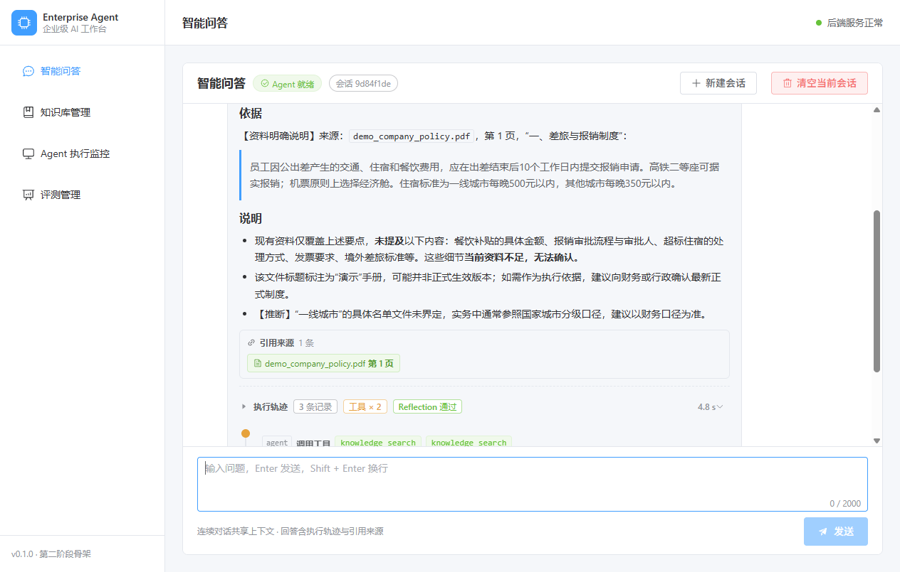
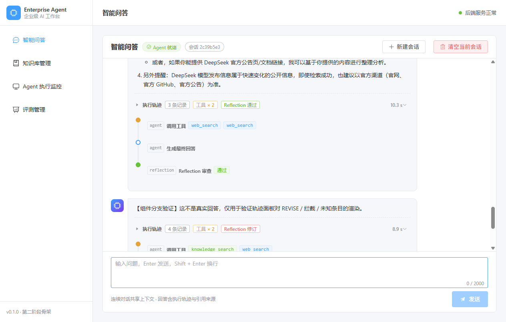
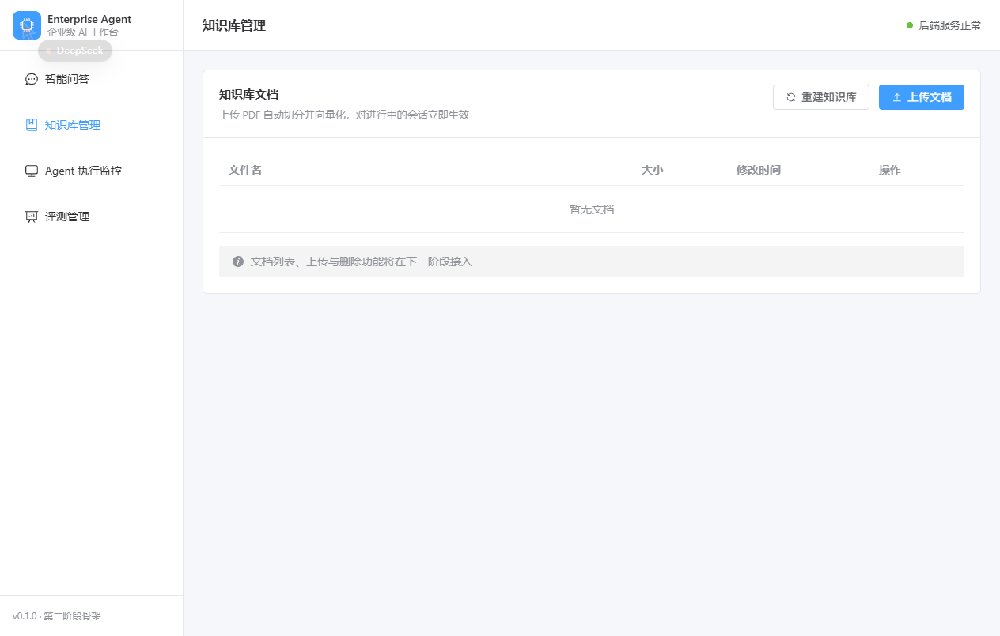
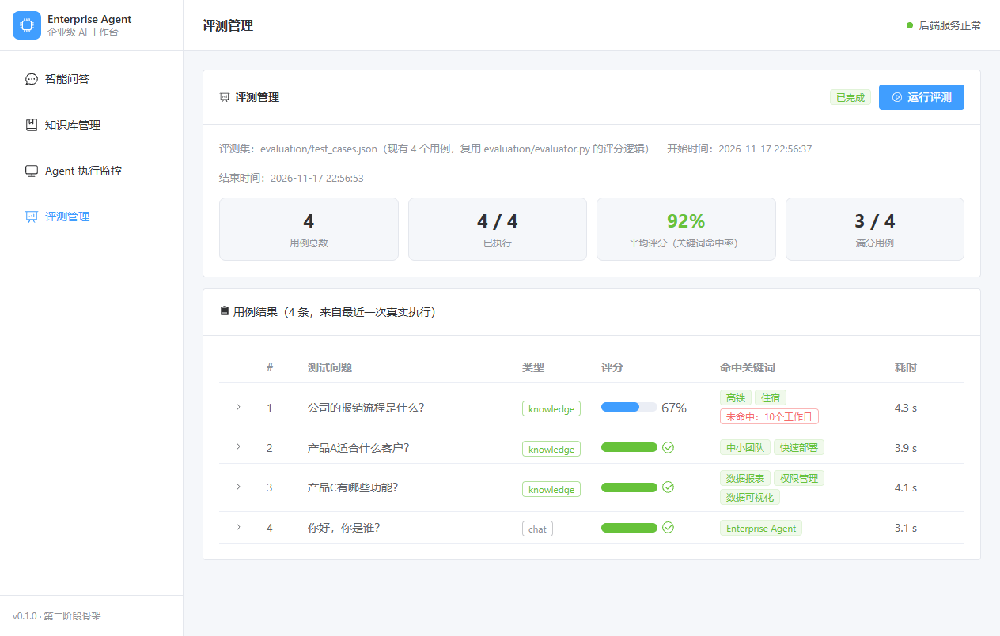
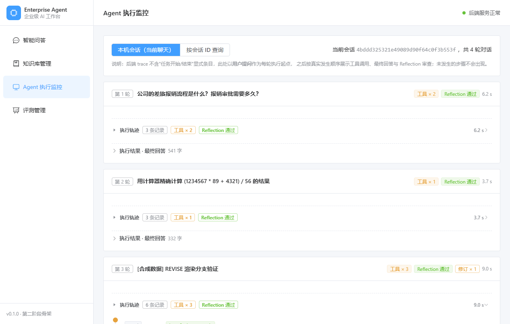
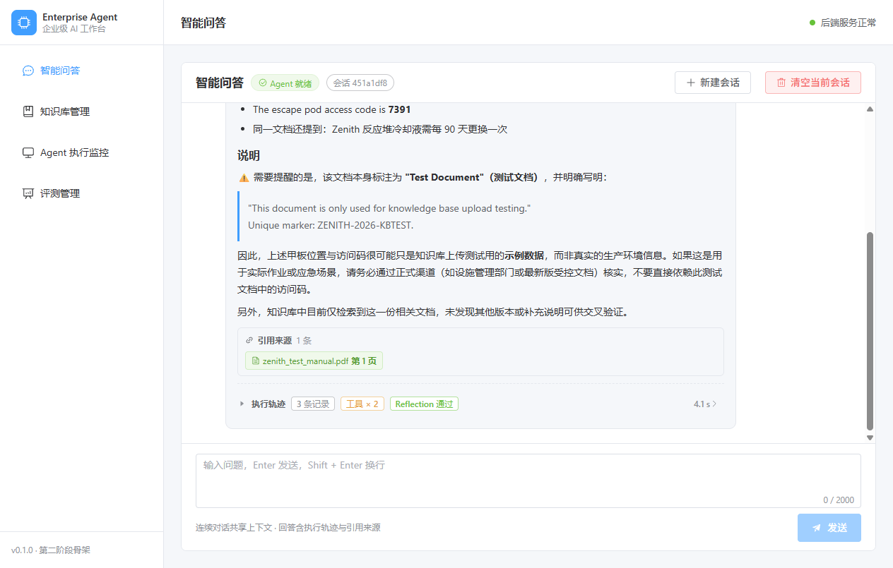

# Enterprise Agent · 企业级智能问答系统

基于 **LangGraph 多轮反思 Agent + RAG 知识库 + FastAPI + Vue3** 的企业知识问答与管理工作台。
Agent 可以检索企业内部 PDF 知识库、联网搜索公开信息、进行精确计算，并在给出答案前经过
Reflection（自我审查）环节，回答中明确标注依据来源（文件名/页码/网页链接），资料不足时如实说明而非编造。

## 1. 项目简介

本项目包含三层：

- **Agent 核心**（`agent/`）：LangGraph 状态图驱动的企业问答 Agent（graph/core/rag/tools/evaluation
  五个模块），支持 knowledge_search / web_search / calculator 三个工具、按 thread 的多轮对话记忆、
  Reflection 审查与 REVISE 修订循环。
- **FastAPI 后端**（`backend/`）：将 Agent 封装为 REST API —— 聊天问答、会话管理、
  知识库文档上传/删除/重建、评测触发与结果查询。纯组合式封装，不改动 Agent 内核。
- **Vue3 前端**（`frontend/`）：智能问答 / 知识库管理 / Agent 执行监控 / 评测管理四个页面，
  Markdown 渲染 + 引用来源展示 + 执行轨迹时间线。

另保留历史版本入口：Streamlit 单体应用（`app.py`）与 CLI（`cli.py`），可独立运行。

## 2. 技术栈

| 层 | 技术 |
|---|---|
| Agent 编排 | LangGraph 1.2、LangChain 1.4（MemorySaver 多轮记忆 / 反思循环） |
| LLM | DeepSeek（OpenAI 兼容接口，`langchain-openai`） |
| RAG | FAISS（faiss-cpu）、BAAI/bge-small-zh-v1.5 本地 Embedding、RecursiveCharacterTextSplitter |
| 文档解析 | pypdf |
| 联网搜索 | SerpAPI（Google 引擎） |
| 后端 | Python 3.13、FastAPI、Uvicorn、pydantic |
| 前端 | Vue 3.5、Vite 7、Element Plus 2.9、Vue Router 4、Axios、markdown-it + highlight.js + DOMPurify |
| 测试 | httpx（API 冒烟 / 验收 / 异常注入脚本） |

## 3. 系统架构图

```
┌─────────────────────────── Vue3 前端 (Vite, 127.0.0.1:5173) ───────────────────────────┐
│  智能问答      知识库管理        Agent 执行监控        评测管理                          │
│  Markdown渲染  上传/删除/重建    trace 时间线可视化     用例结果/评分                   │
└─────────────────────────────────── Axios (HTTP) ─────────────────────────────────────┘
                                     │  VITE_API_BASE_URL
                                     ▼
┌────────────────────────── FastAPI 后端 (Uvicorn, 127.0.0.1:8000) ─────────────────────┐
│  routers: /api/chat /api/sessions   /api/documents/{upload,delete,rebuild}            │
│           /api/evaluation/{run,results}   /api/health                                 │
│  services: AgentService(会话LRU+串行锁)  DocumentService(校验链+KB写锁+失败回滚)      │
│            EvaluationService(后台线程+防重复)                                          │
└──────────────────────────────────────┬───────────────────────────────────────────────┘
                                       │ bootstrap 组合根（共享同一 KnowledgeBase 实例）
                                       ▼
┌────────────────────────── Agent 核心（LangGraph 状态图） ─────────────────────────────┐
│   START → agent ⇄ tools（防重复调用拦截） → final → reflection                        │
│                         ▲                            │ PASS → END                     │
│                         └──────── REVISE ────────────┘                                │
│   工具: knowledge_search(FAISS检索,带来源/页码)  web_search(SerpAPI)  calculator(AST) │
│   记忆: MemorySaver（按 session_id/thread_id 累积多轮）                                │
└──────────────────────────────────────┬───────────────────────────────────────────────┘
                                       ▼
              data/documents/*.pdf  ←→  data/vector_store/ (FAISS 索引, 运行时生成)
```

## 4. 核心功能

- **智能问答**：多轮连续对话；Agent 自主决定是否调用工具；回答附引用来源（PDF 文件名+页码 /
  网页标题+链接，均来自工具真实返回，不编造）；可展开查看每轮执行轨迹（调用了哪些工具、
  最终回答、Reflection 结果 PASS/REVISE）。
- **知识库管理**：PDF 上传（文件名净化/大小 20MB 上限/PDF 魔数校验/重名拒绝，上传失败自动
  回滚残留文件）、删除（二次确认，FAISS 同步重建）、全量重建；上传后立即可检索、删除后立即不可检索。
- **Agent 执行监控**：查看本机或任意会话的逐轮执行记录，轨迹时间线严格展示真实 trace，
  不伪造未发生的步骤。
- **评测管理**：触发内置 4 用例评测（复用 `agent/evaluation/evaluator.py` 的用例与关键词命中率
  评分），后台线程执行、运行中防重复提交（409），结果含每例得分/命中与未命中关键词/真实回答。
- **安全设计**：`.env` 密钥不入库；前端零密钥、零硬编码地址；上传/删除路径穿越防护；
  统一错误结构 `{"detail":{"code","message"}}`。

## 5. 项目目录结构

```
enterprise-agent/
├── agent/                     # Agent 核心（LangGraph 状态图 + RAG + 工具 + 评测）
│   ├── graph.py               # EnterpriseAgent.ask(question, thread_id) -> (answer, trace)
│   ├── prompts.py             # 系统提示词 / Reflection 审查提示词
│   ├── core/                  # 配置 / LLM 工厂 / 工具注册表
│   ├── rag/                   # 知识库（FAISS 增删重建）与文档管理
│   ├── tools/                 # knowledge_search / web_search / calculator
│   └── evaluation/            # 评测器与用例（test_cases.json）
├── backend/                   # FastAPI 后端（封装层，不重复实现内核逻辑）
│   ├── main.py                # 应用工厂 + lifespan + 异常处理 + CORS
│   ├── bootstrap.py           # 组合根：单例装配，工具闭包与文档管理共享同一 KB 实例
│   ├── schemas.py             # 请求/响应模型
│   ├── errors.py              # 业务异常体系
│   ├── deps.py                # 依赖注入
│   ├── routers/               # chat / documents / evaluation
│   └── services/              # AgentService / DocumentService / EvaluationService
├── frontend/               # Vue3 前端
│   ├── src/api/            #   axios 封装 + 模块化接口
│   ├── src/views/          #   Chat / Knowledge / AgentMonitor / Evaluation
│   ├── src/components/     #   TraceTimeline / CitationList / PagePlaceholder
│   ├── src/store/          #   chatSession（SPA 内会话状态）
│   └── src/utils/          #   markdown 渲染 / 引用解析 / 格式化
├── data/
│   └── documents/          # 知识库 PDF（含两份演示文档）
├── docs/screenshots/       # 各阶段页面截图
├── Test/                   # 冒烟 / 验收 / 异常注入测试脚本 + 测试 PDF 生成器
├── app.py                  # Streamlit 历史版本（保留）
├── cli.py                  # CLI 历史版本（保留）
└── requirements.txt
```

## 6. 环境配置

1. Python 3.11+（开发环境为 3.13），Node.js 18+（开发环境为 24）。
2. 复制 `.env.example` 为 `.env`，填入：

```dotenv
LLM_API_KEY=sk-xxxx          # 必填：DeepSeek API Key（缺失时后端拒绝启动并明确报错）
LLM_BASE_URL=https://api.deepseek.com
LLM_MODEL_ID=deepseek-v4-flash
SERPAPI_API_KEY=xxxx         # 可选：联网搜索；未配置时 web_search 返回提示文本
EMBEDDING_MODEL=BAAI/bge-small-zh-v1.5
TOP_K=4
MAX_REFLECTIONS=1
```

3. 前端环境变量（`frontend/.env.development` / `.env.production`）：

```dotenv
VITE_API_BASE_URL=http://127.0.0.1:8000   # 生产部署改为实际后端地址
```

> Embedding 模型首次运行自动从 HuggingFace 下载（约 95MB），之后走本地缓存。
> FAISS 索引（`data/vector_store/`）不入库，首次启动后端会自动从 `data/documents/` 全量构建。

## 7. 启动步骤

**后端（FastAPI）：**

```powershell
cd enterprise-agent
python -m venv .venv
.venv\Scripts\pip install -r requirements.txt        # 建议使用国内镜像
copy .env.example .env                                # 编辑填入 LLM_API_KEY
.venv\Scripts\python -m uvicorn backend.main:app --host 127.0.0.1 --port 8000
# Swagger 文档: http://127.0.0.1:8000/docs
```

**前端（Vite）：**

```powershell
cd frontend
npm install
npm run dev
# 打开 http://127.0.0.1:5173
```

**（可选）历史版本：** `streamlit run app.py` 或 `.venv\Scripts\python cli.py`。

## 8. 页面截图

| 智能问答（Markdown+引用+轨迹） | 执行轨迹分支 |
|---|---|
|  |  |

| 知识库管理 | 评测结果 |
|---|---|
|  |  |

| Agent 执行监控（REVISE 分支） | 上传后检索验证 |
|---|---|
|  |  |

## 9. API 接口说明

统一前缀 `/api`；错误统一为 `{"detail":{"code","message"}}`。

| 方法 | 路径 | 说明 | 关键参数 / 返回 |
|---|---|---|---|
| GET | `/api/health` | 健康检查 | → `{status, version, agent_ready, document_count, vector_store_loaded, llm_configured, web_search_configured}`（只返回布尔，不暴露密钥） |
| POST | `/api/chat` | 智能问答 | 请求 `{question: 1..2000, session_id?: ^[A-Za-z0-9_-]{1,64}$}` → `{session_id, answer, trace[], elapsed_ms}`；trace 条目：`{node:agent, action:tool_call, detail:[工具名]}` / `{node:agent, action:final_answer}` / `{node:reflection, action:PASS\|REVISE, detail:审查全文}` |
| GET | `/api/sessions/{id}/history` | 会话历史 | → `{session_id, count, messages[{role,content,trace,created_at}]}`；不存在 → 404 |
| DELETE | `/api/sessions/{id}` | 删除会话 | → `{success}` |
| GET | `/api/documents` | 文档列表 | → `{total, documents[{filename,size_bytes,modified_at}]}` |
| POST | `/api/documents/upload` | 上传 PDF | multipart `file`；校验链：文件名净化→非空→≤20MB→PDF 魔数→重名 409 → `201 {filename, chunks, warning}`；解析失败 502 且不留残留文件 |
| DELETE | `/api/documents/{filename}` | 删除文档（FAISS 同步重建） | → `{success, file, remaining_chunks}`；不存在 404 |
| POST | `/api/documents/rebuild` | 全量重建索引 | → `{chunks}` |
| POST | `/api/evaluation/run` | 触发评测 | → `202 {status:"running", total_cases}`；运行中重复提交 409 |
| GET | `/api/evaluation/results` | 评测结果 | → `{status, summary{total,executed,average_score,full_score_count,case_failed_count}, cases[{question,answer,score,matched/missed_keywords,elapsed_ms,error}]}` |

## 10. 测试说明

所有测试脚本位于 `Test/`，直接对运行中的服务发起真实 HTTP 请求（httpx，绕过系统代理直连本机）。

| 脚本 | 内容 |
|---|---|
| `api_smoke_test.py` | 18 项接口冒烟：健康/列表/非法上传/重名/正常上传/删除/路径穿越/两轮对话/历史/会话删除 |
| `final_acceptance_test.py` | 22 项整体验收（A1–A10）：工具调用/多轮上下文/知识引用/上传入库可检索/删除后不可检索（FAISS 同步）/重建/评测全链路 |
| `exception_test.py` | 17 项 HTTP 级异常：非 PDF/空文件/伪造 PDF/删除不存在/路径穿越/超长问题/非法 session/不存在会话/除零工具错误 |
| `env_failure_test.py` | 10 项环境故障注入（临时起 8001 实例）：无效/缺失 LLM Key（fail-fast）、LLM 超时、无效搜索 Key（工具失败不击穿） |
| `make_test_pdf.py` | 生成带唯一标记的测试 PDF（用于上传/检索/删除验证） |

```powershell
# 依次运行（需后端已启动，验收脚本会真实调用 LLM，约 2 分钟）
.venv\Scripts\python Test\api_smoke_test.py
.venv\Scripts\python Test\final_acceptance_test.py
.venv\Scripts\python Test\exception_test.py
.venv\Scripts\python Test\env_failure_test.py      # 自动拉起/销毁 8001 临时实例
```

## 已知限制

- `/api/health` 的 `llm_configured` / `web_search_configured` 只校验环境变量非空，不代表 Key 有效。
- 评测结果保存在内存中，重启后清空；关键词命中率为字面匹配，非语义评分。
- FAISS 写操作（上传/删除/重建）通过全局写锁串行化，但检索存在极小的读写竞态窗口（一期设计）。
- `web_search` 依赖 SerpAPI 配额；未配置/失效时 Agent 会如实说明搜索失败，不编造链接。
- Streamlit 版（`app.py`）为历史保留版本，未共享 FastAPI 版的修复（空索引启动、上传入索引等），建议使用 FastAPI + Vue 版本。

## License

仅用于学习与内部演示。
